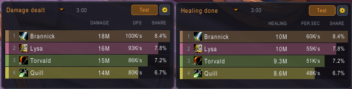
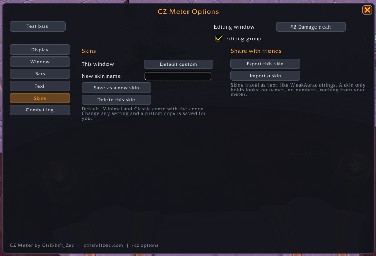
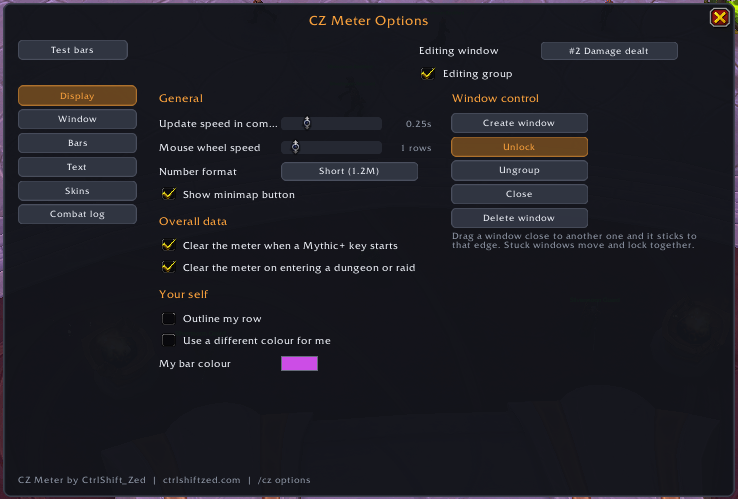

# CZ Meter

**A light, modern damage meter for World of Warcraft: Midnight.** Since Midnight, every damage meter reads the same numbers from the game's own meter. CZ Meter is built around making those numbers easy to read: a clean window that stays small, live bars through boss fights and Mythic+ keys, and a click away from anyone's spell breakdown.

[Get it on CurseForge](https://www.curseforge.com/wow/addons/czmeter) | [Wiki](wiki/Home.md) | [Website](https://ctrlshiftzed.com/cz-meter) | [Discord](https://discord.gg/wz7fw6jM9Z)

- **Live bars:** bars and numbers keep moving through boss fights and keys, in Blizzard's own order.
- **Every metric:** damage, healing, absorbs, damage taken, avoidable damage, interrupts, dispels, deaths and damage into each enemy.
- **Fight history:** the current fight, the overall total or any earlier pull.
- **Best try:** your group's best pull of the last boss next to the one you just did.
- **Player details:** click a row for that player's spells, targets and defensive numbers.
- **More than one window:** up to six, each with its own metric. Drag them together and they snap into a group that moves and locks as one.
- **Skins you can share:** Default, Minimal and Classic built in, or make your own and send it to a friend as a text string.
- **Your own row:** outlined and always on the list, even when you're below the cut.
- **Item level badges** next to each player, read out of combat.
- **Light on your frame rate:** a few redraws a second in combat, and nothing at all out of combat unless something changed.

No setup. Install it, type `/cz`, and the meter is there.

**New here?** The [wiki](wiki/Home.md) explains every feature step by step (also on the [website](https://ctrlshiftzed.com/wiki/cz-meter/)). Questions it doesn't answer: ask on [Discord](https://discord.gg/wz7fw6jM9Z).

## The window

Each row shows the player's rank, spec icon, name, item level, total and per second, with share as an option. Step through metrics with the arrows or pick one from the list, switch between **Current**, **Overall** and earlier pulls, and flip from **Players** to **Enemies** to see how much damage went into each enemy type. **My DPS** shows only your row, **Top** sets how many rows to show, and the copy button gives you the numbers as text to paste into chat. Windows keep a fixed height and scroll with the mouse wheel, so a full raid fits, or they can grow with the number of rows.

## Player details

Click any player's row to open their breakdown for that window's metric and fight. The header shows their total, per second, share of the group and rank. **Spells** lists each ability with its total, per second and share of the player's total; hover one for overkill and targets. **Targets** adds up damage per target where the game gives a split. **Defense** shows damage taken, avoidable damage, absorbs, healing, interrupts, dispels and deaths, each with a rank, and the spells that hit them hardest, with avoidable ones in red.

## Several windows, snapped together

Open a new window from the window menu and it picks the next metric, so one can show damage and another healing. Drag a window close to another and it sticks to that edge. Stuck windows move together when you drag any of them, lock together, and come apart again with **Ungroup**.

## Skins

Three skins come built in: **Default** (rounded, with item level badges), **Minimal** (flat, see-through, compact toolbar) and **Classic** (textured bars and outlined text). Change anything you like and a custom copy is saved for you, so the built-in ones never change. **Export** gives you a short text string to send to a friend, and **Import** adds theirs to your list. A skin only holds looks: no names and nothing from your meter.

## Options

Pick the window you're editing at the top, tick **Editing group** to change every window stuck to it at once, then work through the pages:

- **Display:** update speed in combat, mouse wheel speed, short or full numbers, clearing the meter when a key starts or when you enter a new dungeon or raid, your own row, and creating, locking, closing or deleting windows.
- **Window:** skin, width, height, scale, how many rows, toolbar size, column headings, background, border and accent colours.
- **Bars:** row height and gap, texture, direction, class colours or one colour, brightness, opacity and the class stripe.
- **Text:** font, size, outline, colours, and which columns show (also under Columns in each window's menu).
- **Skins:** save, delete, export and import.
- **Combat log:** start it automatically in raids and Mythic+ (or every dungeon and raid), with a warning when Advanced Combat Logging is off.

**Test bars** fill every window with 25 made-up players, so you can try skins and see a full raid list without being in one.

## Numbers in combat

In Midnight the game hides meter values from addons during combat. CZ Meter can still draw them, so bars and numbers stay live, and anything it works out itself (share, the spell breakdown, item levels) fills in once the fight ends. Your own details open any time; other players' details open once combat ends.

## Combat log and disk space

Automatic logging is off unless you turn it on. When CZ Meter starts the log, it stops it again when you leave the instance or log out, and never touches a log you started yourself. Log files can reach several GB after a few raid nights and addons can't delete files, so CZ Meter counts the hours it has logged and reminds you to clear old files from your Logs folder (after 10 hours by default, or never).

## Commands

| Command | What it does |
|---|---|
| `/cz` | Show or hide the meter (or right-click the minimap button) |
| `/cz options` | The options (also left-click the minimap button, or Esc > Options > AddOns) |
| `/cz new` | Open another window |
| `/cz lock` | Lock or unlock every window |
| `/cz test` | Test bars on or off |

## Good to know

- Retail (Midnight) only.
- Built on the game's own meter data, so the totals match Blizzard's meter.
- Enemy rows merge identical adds into one row, and their per second figure isn't shown because the game's doesn't match the total.
- Found a bug or have an idea? [Open an issue](https://github.com/VaughanT31/CZMeter/issues/new/choose) or ask on [Discord](https://discord.gg/wz7fw6jM9Z).

## Also by CtrlShiftZed

- [Recommended Stats](https://www.curseforge.com/wow/addons/recommended-stats): stat priority, BiS gear, talents and rotation from the top players of your spec.
- [Push Planner](https://www.curseforge.com/wow/addons/push-planner): the fastest set of Mythic+ keys to reach your target rating.
- [Party iLvl Check](https://www.curseforge.com/wow/addons/party-item-level-checker): your group's item level, M+ score and buffs the moment you enter a dungeon.
- [Alt Inventory](https://www.curseforge.com/wow/addons/alt-inventory-tracker): how many of an item each of your characters has, right in the tooltip.
- [Auction Coach](https://www.curseforge.com/wow/addons/auction-coach): plain-English Auction House advice, a simpler alternative to TSM.
- [Trust Crafter](https://www.curseforge.com/wow/addons/trust-crafter): remembers who crafted your orders and how well, with guild sharing you can check.
- [Patron Planner](https://www.curseforge.com/wow/addons/patron-planner-better-view-of-patron-orders): see which crafting orders are worth doing and work through them from one queue.

## Support

CZ Meter is free. If it helps you, you can [buy me a coffee](https://ko-fi.com/G2G01YLR68).

## License

MIT, see [LICENSE](LICENSE).
